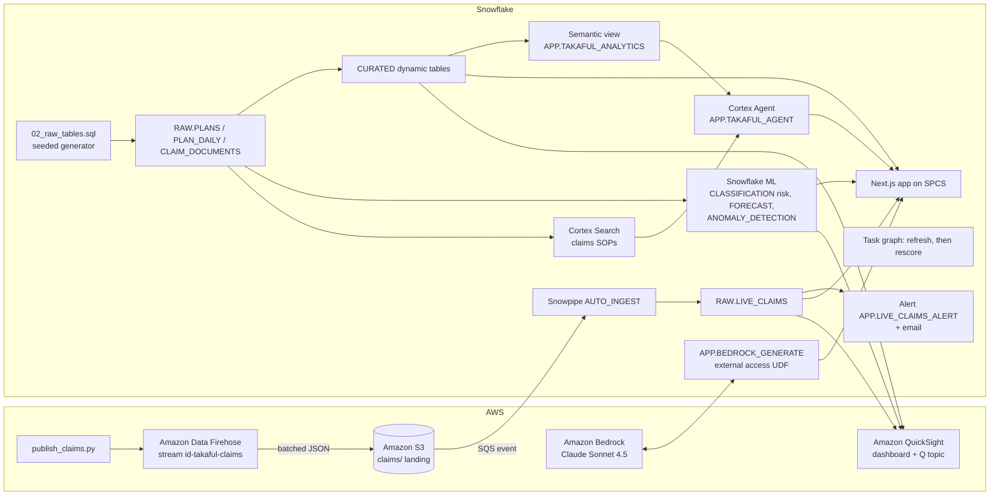

# Indonesia Takaful Claims Operations - Claims Referral and Settlement Monitoring

End-to-end claims operations for **40 takaful plans at a fictional Indonesian takaful operator across 5 cities** (Jakarta, Surabaya, Bandung, Medan, Makassar) using Snowflake, optionally with AWS: from a live claim notification to a 7-day investigation-referral risk score, an alert email and an AI action memo for the claims team.

## Architecture

A claims pipeline built on **Snowflake** (Dynamic Tables, Snowflake ML, Cortex Search, Cortex Agent, Cortex AI_COMPLETE, SPCS) and, in the full build, **AWS** (Amazon Data Firehose, S3, Bedrock Claude, QuickSight + Amazon Q). Claim events land in `RAW.LIVE_CLAIMS`. Dynamic tables curate 90 days of plan-day history: contributions received, claims notified, referrals to claims investigation, settlement SLA breaches, claims per 1,000 contributions and claims file audit compliance. Snowflake ML scores the 7-day risk that a plan's claims are referred to investigation, forecasts operator-wide claims volume and flags claim document rejection rate anomalies. A Cortex Agent answers questions with SOP citations, and an LLM drafts the claims action memo.

In takaful, participants pay contributions into a participants' risk fund, and claims are paid from that fund. The plans cover five product lines: health, motor, family, property and SME takaful. The demo models claims operations only. It does not make Sharia, legal or regulatory rulings, and its SOPs are synthetic.

Interactive diagrams (hover for object names): [Snowflake only](docs/architecture-snowflake.html) | [AWS + Snowflake](docs/architecture-aws.html). The app shows both on its Architecture & Data tab, the current build first. Regenerate them with `python3 docs/build_architecture.py`.



The Snowflake-only build drops the AWS subgraph: `APP.SIMULATE_CLAIMS` writes to `RAW.LIVE_CLAIMS`, and the app calls Cortex `AI_COMPLETE` instead of the Bedrock UDF.

## Snowflake Capabilities

| Capability | Implementation |
|-----------|---------------|
| Dynamic Tables | `CURATED.KPI_SUMMARY`, `PERFORMANCE_SUMMARY`, `CLAIMS_SUMMARY`, `TREND_ANALYSIS` from the RAW tables |
| Snowflake ML | CLASSIFICATION 7-day investigation-referral risk (`ML.ESCALATION_RISK_SCORES`), 14-day claims-volume FORECAST, claim document rejection rate ANOMALY_DETECTION |
| Cortex Search | 14 synthetic claims-handling SOPs (one per takaful product and claim cause) in `SEARCH.CLAIMS_SOP_SEARCH` |
| Semantic View | `APP.TAKAFUL_ANALYTICS` over plans, claim causes, daily totals and risk |
| Cortex Agent | `APP.TAKAFUL_AGENT`: Cortex Analyst over the semantic view plus Cortex Search for SOP citations |
| Cortex AI | `AI_COMPLETE('claude-sonnet-4-5')` for grounded answers, and for the action memo in the Snowflake-only build |
| Alerts + Tasks | `APP.LIVE_CLAIMS_ALERT` logs REFERRED claims and sends email; task graph `TASK_REFRESH_CURATED`, then `TASK_RESCORE_RISK` |
| Snowpark Container Services | Next.js app `APP.ID_TAKAFUL_APP` with 6 tabs: Executive Cockpit, Predictive, Controls, Live Claims, Ask AI, Architecture & Data |
| Snowpipe | `RAW.LIVE_CLAIMS_PIPE` AUTO_INGEST from S3 (AWS build only) |

## AWS Services

Used only in the AWS + Snowflake build.

| Service | Role in Demo |
|---------|-------------|
| Amazon Data Firehose | Direct PUT stream `id-takaful-claims` receives simulated claim events and writes batches to S3 |
| Amazon S3 | Landing bucket (`claims/`). An event notification goes to the Snowpipe SQS queue |
| Amazon Bedrock | Claude Sonnet 4.5 writes the action memo, called from Snowflake through an external-access UDF |
| Amazon QuickSight | DIRECT_QUERY executive dashboard over Snowflake (daily claims, referrals by plan, referral risk) |
| Amazon Q | Natural-language questions over the QuickSight topic `id-takaful-topic` |
| AWS IAM | Least-privilege roles for S3, Firehose and Bedrock |

## Personas

These personas are fictional.

| Persona | Role | Key Questions |
|---------|------|---------------|
| **Ratna Wulandari** | Head of Claims | "How many claims are we notified per 1,000 contributions?" "Which claim causes are referred to claims investigation?" |
| **Budi Santoso** | Claims Analyst | "Which plans are high risk this week, and which SOP applies?" |

## Data

All data is synthetic and seeded, so every rebuild reproduces it. The operator, plans and names are fictional; the cities are real Indonesian cities used as regions.

| Table | Rows | Description |
|-------|------|-------------|
| RAW.PLANS | 40 | Takaful plans across 5 cities and 5 products (Health, Motor, Family, Property and SME takaful), with participant risk grade |
| RAW.PLAN_DAILY | 3,600 | Daily plan observations over 90 days: contributions received, contribution value (IDR), claims notified, referrals to investigation, settlement SLA breaches, claim cause, claims file audits, claim document rejection rate and average days to settle |
| RAW.CLAIM_DOCUMENTS | 40 | Required, on-file and pending claim file documents per plan |
| SEARCH.CLAIMS_DOCS | 14 | Synthetic claims-handling SOPs indexed for Cortex Search |
| RAW.LIVE_CLAIMS | Grows during the demo | Live claim events from Firehose (AWS build) or `APP.SIMULATE_CLAIMS` (Snowflake-only build) |
| ML.ESCALATION_RISK_SCORES | 40 | 7-day investigation-referral probability and risk band per plan |

## Build Instructions

### Prerequisites
- Snowflake account with ACCOUNTADMIN access, and Cortex AI enabled (AI_COMPLETE, Search, Agent).
- An X-Small warehouse with auto-suspend at or below 120 s, and an existing SPCS compute pool.
- Python 3.11+, `snowflake-connector-python`, Node.js 22+, Docker and the `snow` CLI.
- App image: run `snow spcs image-registry login`, then build and push `id-takaful-app:v1` to the database's `APP.IMAGES` repository (see the header of `snowflake/07_deploy_app.sql`).
- AWS build only: `boto3`, AWS credentials for the target account (us-west-2) with Bedrock access, and QuickSight Enterprise.

### SPCS App
```
<DATABASE>.APP.ID_TAKAFUL_APP
```

### Tests
```bash
python -m pytest aws snowflake quicksight
```

For a local run, put `SNOWFLAKE_ACCOUNT`, `SNOWFLAKE_USER`, `SNOWFLAKE_DATABASE`, `SNOWFLAKE_WAREHOUSE`, `SNOWFLAKE_AUTHENTICATOR=PROGRAMMATIC_ACCESS_TOKEN`, `SNOWFLAKE_TOKEN` and `DEMO_PLATFORM` in the environment, then run `npm --prefix app run build && npm --prefix app start`.

## Build Modes

Both modes share the same core. They differ in three places, and the app's `DEMO_PLATFORM` setting (in its SPCS spec) switches the memo provider and the Live Claims tab.

| Layer | Snowflake Only | Full AWS + Snowflake |
|---|---|---|
| Live claims | `CALL APP.SIMULATE_CLAIMS(n)` inserts simulated claim events into `RAW.LIVE_CLAIMS`. This simulates a claim feed; it is not Snowpipe Streaming | `aws/publish_claims.py` to Amazon Data Firehose, then S3, SQS and Snowpipe AUTO_INGEST |
| Action memo | Cortex `AI_COMPLETE('claude-sonnet-4-5')` | Amazon Bedrock Claude Sonnet 4.5 through `APP.BEDROCK_GENERATE` |
| BI and natural-language questions | The SPCS app is the dashboard; questions go to the Cortex Agent | Also a QuickSight dashboard and an Amazon Q topic |
| App setting | `DEMO_PLATFORM: snowflake` | `DEMO_PLATFORM: aws` |

### Snowflake Only

```bash
# 1. Core data and dynamic tables (guarded: new isolated database only)
python snowflake/run_core.py --database INDONESIA_TAKAFUL_SNOWFLAKE --warehouse <XS_WAREHOUSE> --connection <CONNECTION> --apply
# 2. Native claim feed, ML, search, semantic view, agent, alert and task graph
python snowflake/run_intelligence.py --database INDONESIA_TAKAFUL_SNOWFLAKE --platform snowflake --warehouse <XS_WAREHOUSE> --connection <CONNECTION> --alert-email you@example.com
# 3. App on SPCS with DEMO_PLATFORM=snowflake (push the image first)
python snowflake/run_intelligence.py --database INDONESIA_TAKAFUL_SNOWFLAKE --platform snowflake --warehouse <XS_WAREHOUSE> --connection <CONNECTION> --alert-email you@example.com --files 07_deploy_app.sql --compute-pool <COMPUTE_POOL>
```

During the demo:
- Run `CALL APP.SIMULATE_CLAIMS(20)` to add live claim events. For a continuous feed, run `ALTER TASK APP.TASK_SIMULATE_CLAIMS RESUME`, and `SUSPEND` it afterwards.
- Run `EXECUTE ALERT APP.LIVE_CLAIMS_ALERT` to raise the alert email.
- Run `EXECUTE TASK APP.TASK_REFRESH_CURATED` to refresh the curated tables and rescore escalation risk.

Afterwards, drop the database or run `ALTER SERVICE APP.ID_TAKAFUL_APP SUSPEND`.

### Full AWS + Snowflake

```bash
# 1. Core data and dynamic tables (guarded: new isolated database only)
python snowflake/run_core.py --database INDONESIA_TAKAFUL_AWS --warehouse <XS_WAREHOUSE> --connection <CONNECTION> --apply
# 2. AWS ingestion and Bedrock (dry run first, then --apply)
python aws/setup_aws.py --database INDONESIA_TAKAFUL_AWS --account <AWS_ACCOUNT_ID> --connection <CONNECTION> --apply
# 3. ML, search, semantic view, agent, alert and task graph
python snowflake/run_intelligence.py --database INDONESIA_TAKAFUL_AWS --platform aws --warehouse <XS_WAREHOUSE> --connection <CONNECTION> --alert-email you@example.com
# 4. App on SPCS with DEMO_PLATFORM=aws (push the image first)
python snowflake/run_intelligence.py --database INDONESIA_TAKAFUL_AWS --platform aws --warehouse <XS_WAREHOUSE> --connection <CONNECTION> --alert-email you@example.com --files 07_deploy_app.sql --compute-pool <COMPUTE_POOL>
# 5. QuickSight dashboard and Q topic (needs an existing Snowflake data source)
python quicksight/build_dashboards.py --database INDONESIA_TAKAFUL_AWS --account <AWS_ACCOUNT_ID> --principal-arn <QUICKSIGHT_USER_ARN> --data-source-arn <DATA_SOURCE_ARN> --prefix id-takaful --apply --update --with-topic
```

QuickSight objects must be shared with the QuickSight user who signs in (`--principal-arn`); otherwise the console shows nothing.

During the demo:
- Run `python aws/publish_claims.py --count 20` to send live claim events. Firehose buffers for up to 60 seconds before writing to S3.
- Run `EXECUTE ALERT APP.LIVE_CLAIMS_ALERT` to raise the alert email.
- Run `EXECUTE TASK APP.TASK_REFRESH_CURATED` to refresh the curated tables and rescore escalation risk.

Afterwards, `python aws/teardown_aws.py --database INDONESIA_TAKAFUL_AWS --account <AWS_ACCOUNT_ID> --connection <CONNECTION> --apply` removes the AWS resources and the account-level Bedrock external-access and S3 storage integrations. It leaves the email integration `ID_TAKAFUL_EMAIL_INT`, which the Snowflake-only build also uses.

## Business Impact

Industry research and Snowflake customer outcomes:
- **Claims experience drives retention**: "$170 billion in premium is at risk over the next 5 years as customers switch carriers due to not being fully satisfied by the claims process" -- [Accenture, Transforming claims and underwriting with AI](https://www.accenture.com/us-en/insights/insurance/ai-transforming-claims-underwriting)
- **Emirates Insurance** (Snowflake customer) reports "30-40% faster motor claims registration with AI" and "380 hours of work automated over 3 months" -- [Snowflake customer story: Emirates Insurance](https://www.snowflake.com/en/customers/all-customers/case-study/Emirates/)

## Key Demo Numbers

These figures are synthetic and come from the seeded demo data. Forecast and anomaly figures can shift slightly with the build day.

- **40 plans** across 5 Indonesian cities and 5 takaful products, 3,600 plan-days over 90 days; **748,300 contributions received** worth IDR 378 B
- **595 claims notified** (0.80 per 1,000 contributions), of which **185** were referred to claims investigation (escalation rate 31.1%); **89 settlement SLA breaches**
- **Hospital inpatient stays** produce the most referrals (39 of 165 claims); the 16 flood event claims always settle without investigation
- **Referral risk model** out-of-time holdout: precision 0.54, recall 0.33 at a 0.5 threshold, against a 0.29 base rate. Six plans are high risk; the top plan is PLN-0014, at 89.2%
- **14-day claims forecast** with prediction intervals; **39 of 640** plan-days flagged as claim document rejection rate anomalies
- **Claims file audit compliance 79.2%**, claim file coverage 56.3%, with 23 documents pending
- **14 SOPs** indexed for Cortex Search and cited by ID in agent answers

## License

Apache 2.0 — See [LICENSE](LICENSE) for details.

This is a personal demo project and is not an official Snowflake offering. It comes with no support or warranty. Industry metrics cited are from publicly available third-party sources and Snowflake customer stories; they represent reported outcomes and are not guarantees of results. The demo does not provide Sharia, legal or regulatory advice.
